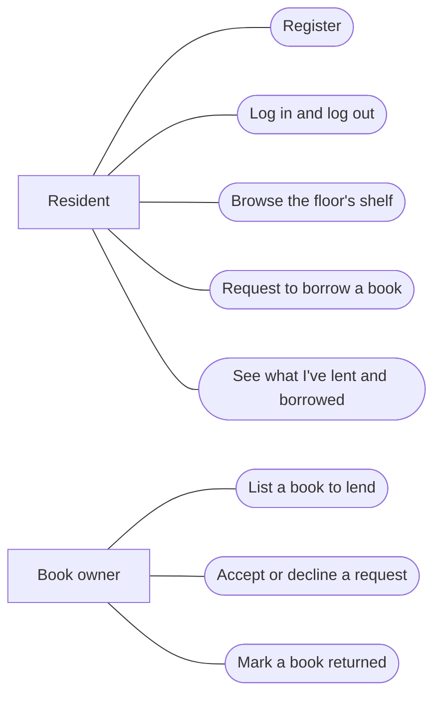

# Project Proposal — Team 012-0

> **Sample.** Made by your TA to show what a complete Lab 8 proposal contains. Every heading
> below is a numbered item from the Lab 8 writeup. Keep the numbers, so the grader can find
> each one. Team 012-0 and the Shelf app are made up.

## 1. Team Number

012-0

## 2. Team Name

Dog-Eared

## 3. Team Members

| First and last name | GitHub username | Email |
| --- | --- | --- |
| Altaf Barelvi | ctrlaltaf | Altaf.Barelvi@colorado.edu |
| `<First Last>` | `<github-username>` | `<identikey>@colorado.edu` |
| `<First Last>` | `<github-username>` | `<identikey>@colorado.edu` |
| `<First Last>` | `<github-username>` | `<identikey>@colorado.edu` |

## 4. Application Name

Shelf

## 5. Application Description

Shelf is a book-lending app for the residents of a single dorm floor. Most students own a
handful of books they have already read, and most of them would happily lend those books to a
neighbour if they knew who wanted them. Shelf makes the floor's combined bookshelf visible:
each resident lists the books they are willing to lend, and everyone else can browse the list.

A resident who finds a book they want sends a borrow request. The owner accepts or declines it,
and Shelf records who has the book and since when. When the book comes back, the owner marks it
returned. Each resident's profile shows what they've lent, what they've borrowed, and what is
overdue.

The scope is deliberately small. One floor, no payments, no shipping, no ratings. The app
succeeds if a resident can go from "I want something to read" to "I have a request in" in
under a minute.

## 6. Audience

Our ideal user is a first- or second-year student living in a residence hall, who reads for
fun but doesn't want to buy every book. The problem we solve is that the books are already on
the floor; there's just no way to see them.

Usability: a resident should be able to list a book with a title and author alone. Accessibility:
every page works with a keyboard alone, form fields have labels, and colour is never the only
signal (an overdue book says "overdue" as well as turning red).

## 7. Vision Statement

For dorm residents who want to read more without buying more, Shelf is a lending app that turns
a floor's scattered bookshelves into one shared library. Unlike a group chat, Shelf remembers
who has which book.

## 8. Version Control

Repository: https://github.com/ctrlaltaf/test-group-project

The repo is public, and every team member has been added as a collaborator. The root holds only
these four entries:

- [`TeamMeetingLogs/`](../TeamMeetingLogs/) — weekly TA meeting minutes
- [`MilestoneSubmissions/`](../MilestoneSubmissions/) — this proposal and later course documents
- [`ProjectSourceCode/`](../ProjectSourceCode/) — the application, with its `.gitignore`
- [`ReadMe.md`](../ReadMe.md)

## 9. Development Methodology

A hybrid of Scrum and Kanban. We'll run one-week sprints that end at our TA meeting, with a
short planning session at the start of each week. Work is tracked as user stories on the GitHub
project board, one branch per story, merged to `main` through a pull request that another team
member reviews.

## 10. Communication Plan

We'll use a Discord server with a channel for each part of the app, plus discussion on the
GitHub issues for each user story. We'll contact the TA by email or in person at our weekly
meeting. No text messages or IMs for project work.

## 11. Meeting Plan

- **Team meeting:** Mondays and Wednesdays, 5:00–6:00 PM, in person in Norlin Library. If
  someone can't come, we join on Discord voice instead.
- **Weekly meeting with TA:** `<day>`, `<time>`, `<location>`, in person. *(Use the slot you
  agreed with your TA in lab.)*

## 12. Use Case Diagram

At least six key features. Shelf has eight.



*(A photo of a hand-drawn diagram is fine too. Whatever you use, it must be readable in the
file you push.)*

## 13. Wireframes

One for every page. Hand-drawn and photographed is acceptable.

**Login**

```
+--------------------------------------+
|  Shelf                               |
+--------------------------------------+
|           Log in to Shelf            |
|   Username [____________________]    |
|   Password [____________________]    |
|            [ Log in ]                |
|   New here? Register                 |
+--------------------------------------+
```

**Register**

```
+--------------------------------------+
|  Shelf                               |
+--------------------------------------+
|          Create an account           |
|   Username [____________________]    |
|   Password [____________________]    |
|   Room no. [______]                  |
|            [ Register ]              |
|   Already have an account? Log in    |
+--------------------------------------+
```

**Home — the floor's shelf**

```
+--------------------------------------------------+
|  Shelf      Home   My books   Profile   Log out  |
+--------------------------------------------------+
|  Search [______________________] [ Search ]      |
|                                                  |
|  Title              Author        Owner   Status |
|  ----------------------------------------------- |
|  Dune               F. Herbert    rm 214  In     |
|  Piranesi           S. Clarke     rm 207  Out    |
|  ...                                             |
+--------------------------------------------------+
```

**Book page**

```
+--------------------------------------------------+
|  Shelf      Home   My books   Profile   Log out  |
+--------------------------------------------------+
|  Dune — Frank Herbert                            |
|  Owner: room 214          Status: available      |
|                                                  |
|           [ Request to borrow ]                  |
+--------------------------------------------------+
```

**My books**

```
+--------------------------------------------------+
|  Shelf      Home   My books   Profile   Log out  |
+--------------------------------------------------+
|  [ + List a book ]                               |
|                                                  |
|  Requests waiting for you                        |
|  Piranesi — rm 211        [ Accept ] [ Decline ] |
|                                                  |
|  Lent out                                        |
|  Dune — rm 207, since Oct 3    [ Mark returned ] |
+--------------------------------------------------+
```

**Profile**

```
+--------------------------------------------------+
|  Shelf      Home   My books   Profile   Log out  |
+--------------------------------------------------+
|  Username: ctrlaltaf        Room: 214            |
|                                                  |
|  Borrowed:  Piranesi (due Oct 30)                |
|  Overdue:   none                                 |
+--------------------------------------------------+
```

## Extra Credit — Risk Analysis

**This section is our submission for extra credit.**

| # | Risk | Severity | Mitigation |
| --- | --- | --- | --- |
| 1 | A team member stops contributing partway through | High | Every story on the board has one named owner; anything untouched for three days gets reassigned at the next team meeting |
| 2 | Code works on one laptop and not another | High | Everything runs in Docker Compose; each pull request is reviewed by running it on a second machine |
| 3 | Merge conflicts the week before a deadline | Medium | One branch per story, small pull requests, merge to `main` at least every other day |
| 4 | Scope creep (ratings, chat, multiple floors) | Medium | Anything outside the eight use cases above goes into a "later" column on the board, not into a sprint |
| 5 | The deployed app is down during the presentation | Medium | Deploy by the end of week 3; record a backup demo video before presenting |
